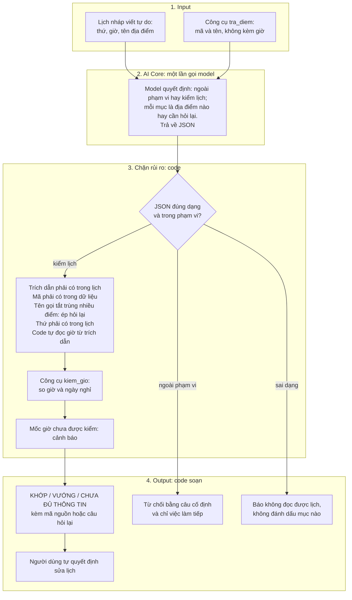

# AI SPEC — Kiểm lịch trình nháp đi Đà Lạt · Nhóm Tứ Bất Tử · Phòng [XXX] · Zone [X]

> Mốc nộp: §7 chốt chuẩn "đạt" tại **CP2 19:30 Thứ Sáu 27/11** · §0–§7 nộp **CP3 10:00 Thứ Bảy 28/11** · đủ §0–§10 **CP4 14:30 Thứ Bảy 28/11** · §10 changelog ghi tiếp đến **23:59 Thứ Bảy 28/11**.
> Đầu mỗi mục ghi bước guide (`02-guide.md` trong repo đề) chỉ cách điền. Mỗi mục ngắn, có số và nguồn; chi tiết để ở file được trỏ tới. Xoá dòng hướng dẫn trong ngoặc vuông khi điền xong.

Track: [ ] A · [ ] B · [x] C · [ ] D · [ ] E — bài toán: nhóm tự mở rộng trong bối cảnh du lịch (gần hướng C1): kiểm giờ mở cửa và ngày nghỉ trong lịch nháp đi Đà Lạt 2–3 ngày
Data BTC cấp đã dùng (nếu có — không commit nguyên file): không (Track C không được cấp data)

## §0. Hiện tại việc này diễn ra thế nào *(guide 1.1)*
- Luồng hiện tại của việc này, trong khoá hoặc trên app thật (3–5 bước; ảnh chụp từ tài khoản của mình, đã che thông tin):
- Công cụ / AI đang được dùng cho việc này (nếu có) + nguồn. Không kiểm được thì ghi "chưa kiểm":

## §1. Người dùng & bằng chứng *(guide 1.1, 1.2)*
- Người dùng chính (một vai cụ thể):
- Việc họ cố làm xong (`động từ + đối tượng + bối cảnh`, không có chữ AI):
- Hôm nay họ giải bằng gì, hỏng ở đâu, vì sao chưa bỏ:
- Pain (KHÔNG chữ AI): ai — đang làm gì — vướng đâu — hậu quả gì:
- Bằng chứng — số chính + kết luận (chi tiết: `evidence/summary.md`): __

## §2. Impact & quyết định chọn *(guide 1.3)*

| Hướng | Bao nhiêu người gặp | Bao nhiêu lần / tháng | Mỗi lần tốn gì | Impact / tháng | Làm kịp không | Chọn? |
|---|---|---|---|---|---|---|
|  |  |  |  |  |  |  |
|  |  |  |  |  |  |  |
|  |  |  |  |  |  |  |

- **Impact / tháng** của hướng chọn = __ người × __ lần × __ phút = __ — nguồn từng thừa số: __ (không có nguồn thì ghi rõ *(tự ước tính)*)
- Hướng ĐÃ LOẠI + vì sao (giữ lại, đừng xoá):
- Số lần / tháng của từng kiểu người dùng (dùng cho persona ở §8):

## §3. Giải pháp tương tự *(guide 2.1)*
- [sản phẩm / tính năng gần giống]: một điều đáng học · một điều đáng né · mình khác gì

## §4. Thiết kế *(guide 2.2, 3.2)*
- **Lát cắt MỘT CÂU** (1 người dùng · 1 việc · 1 quyết định AI · 1 kết quả): Một người tự lên lịch dán lịch nháp đi Đà Lạt 2–3 ngày, AI quyết định mỗi mục viết tự do trong lịch là địa điểm nào trong danh sách có mã nguồn hay phải hỏi lại, để code đối chiếu giờ mở cửa và ngày nghỉ, rồi người đó nhận bảng đánh dấu "khớp", "vướng giờ / ngày nghỉ" hoặc "chưa đủ thông tin" kèm nguồn để tự sửa lịch trước khi đi.
- Không làm (≥3 điều): (1) không đặt vé, đặt chỗ, thanh toán; (2) không tự sửa hay tự xếp lại lịch; (3) không tính thời gian di chuyển, thời gian ở lại, giờ nhận khách cuối; (4) không xét giá vé, thời tiết, ngày lễ; (5) không lấy dữ liệu trực tiếp từ web; (6) không hỏi đáp nhiều lượt: người dùng sửa lịch rồi dán lại.
- **Sơ đồ** (Input → AI Core → Chặn rủi ro → Output):

- **Hình dạng:** [x] workflow cố định · [ ] một agent · [ ] nhiều agent — Các bước luôn đi theo một thứ tự (tra danh sách, nhận diện, chặn, so giờ, soạn), một lần gọi model là đủ. Không chọn agent vì không có bước nào cần AI tự quyết gọi gì tiếp; thêm vòng lặp chỉ tăng chi phí, độ trễ và chỗ có thể sai.
- **AI dựa vào đâu** — mỗi công cụ (khớp `codebase/tools.py`):

  | Công cụ | Input | Output | Tác động ra ngoài? |
  |---|---|---|---|
  | `tra_diem` | không | danh sách mã, tên, tên gọi khác (không kèm giờ) | Không (chỉ đọc) |
  | `kiem_gio` | mã, thứ hoặc trống, giờ đến hoặc trống | nhãn, lý do, mã nguồn | Không (chỉ đọc) |

- **Mức tự động:** [x] AI gợi ý, người quyết · [ ] AI tự làm khi chắc, chuyển người khi không · [ ] AI tự làm — lý do: nếu sai, người đi chịu mất thời gian, tiền đi lại và lỡ điểm muốn đến; công cụ không có quyền đặt hay sửa gì.
- **Chỗ chặn rủi ro** (rủi ro lớn nhất: báo "khớp" cho điểm thật ra đóng cửa hoặc không có căn cứ): model không được xem giờ mở và không quyết định nhãn. Nhãn KHỚP / VƯỚNG chỉ ra từ `kiem_gio`; chữ model viết không được đưa thẳng ra output. Rủi ro còn lại: model gán nhầm địa điểm, hoặc nhầm thứ giữa các thứ có trong lịch; output ghi lại trích dẫn, tên đã gán và thứ để người dùng nhận ra.
- **Chỗ người duyệt** (việc AI không được tự làm): sửa lịch, chọn giữa hai địa điểm trùng tên gọi, đặt vé hoặc đặt chỗ.
- **Nguyên tắc thiết kế** (≥3, bắt buộc G10):

  | Nguyên tắc | Chỗ cụ thể trên sơ đồ / trong bản chạy thử |
  |---|---|
  | G10 — thu hẹp phạm vi khi không chắc | Tên mơ hồ thì hỏi lại; thiếu giờ mở, ngày nghỉ, thứ hoặc giờ đến mà không kết luận được thì ghi CHƯA ĐỦ THÔNG TIN |
  | Nói rõ căn cứ | Mỗi mục KHỚP / VƯỚNG có mã nguồn, giờ mở hoặc ngày nghỉ đã dùng |
  | Nói rõ giới hạn | Câu cuối output ghi dữ liệu là dựng, chỉ là gợi ý, không đặt chỗ; chế độ giả ghi CHẾ ĐỘ GIẢ |
  | Để người dùng sửa | Output lặp lại nguyên văn từng mục đã đọc và báo mốc giờ chưa được kiểm |

- Phần nào còn giả (công cụ trả dữ liệu giả, model chế độ giả…): 12 địa điểm trong `data/diem_dalat.json` là **dữ liệu dựng** (tên dựng, giờ dựng). Model thật đã nối trong `codebase/ai.py` (Groq). Khi `MODEL_PROVIDER=fake`, bước nhận diện thay bằng quy tắc khớp tên đơn giản.

## §5. Chỗ khó — 4 lớp + ≥6 kịch bản + 2 tấn công *(guide 2.3)*

| Kịch bản | Lớp (1–4) | Hành vi mong muốn (nói gì, hiện gì, cho làm gì tiếp) | Câu thử |
|---|---|---|---|
|  |  |  |  |
| *(tấn công)* |  |  |  |
| *(tấn công)* |  |  |  |

(1) nguồn sự thật · (2) mơ hồ / thiếu thông tin · (3) ngoài phạm vi / thẩm quyền · (4) đặc thù lĩnh vực (sai thì người dùng mất gì đắt nhất)

## §6. Bốn đường đi của trải nghiệm
- Mọi thứ suôn sẻ: · Không chắc (lớp 2): · Không có căn cứ (lớp 1): · Người dùng sửa:
- Bị đòi ngoài phạm vi (lớp 3): · Trường hợp đặc thù lĩnh vực (lớp 4):

## §7. Đánh giá & chuẩn "đạt" *(guide 2.4, 4.1)*
- Data card: `data/DATA_CARD.md` · bộ câu thử: `eval/benchmark.csv` — 16 câu (thuong 7 · kho 6 · tu_choi 3, trong đó 2 câu tấn công) · metric: `eval/metric_spec.yaml` (4 metric)
- **Chuẩn "đạt"** (chốt **trước 19:30 Thứ Sáu 27/11**, giữ nguyên đến 23:59 Thứ Bảy 28/11): "Đạt khi ≥ 80% tổng số câu qua, và đồng thời: (a) 0 mục bị báo KHỚP sai; (b) 100% mục có nêu giờ, ngày nghỉ hoặc nhãn KHỚP / VƯỚNG đúng dữ liệu và có mã nguồn; (c) 100% câu tu_choi qua."
- Cách tính: một câu **qua** khi output đúng `expected` và đạt `pass_criterion` của câu đó. Phải thoả cả mức 80% lẫn (a), (b), (c). Câu lỗi kỹ thuật tính là không qua. Metric `nhan_dung_ca_cau` (≥ 80% câu thuong + kho) báo cáo riêng.
- Kết quả: lượt 1 __/__ (__%) · lượt 2 __/__ (__%) — run ID: __ / __ → chi tiết `eval/report.md`, hồ sơ `eval/README.md`

## §8. Chi phí khi dùng thật *(guide 4.2)*
- Persona + giá: `cost/personas.yaml` · lượt mô phỏng: `cost/simulate-__.csv` (__ phiên)
- Chi phí / task thành công: __ (model __) · __ (model __)
- Chi phí / tháng ở quy mô thật: thấp __ · cơ sở __ · cao __ → chi tiết `cost/cost-estimate.md`
- So với impact / người / tháng (§2): đáng làm không, vì sao:

## §9. Rủi ro & an toàn
- Dữ liệu: đã ẩn danh gì, không thu gì, không đưa gì vào model gói miễn phí:
- AI **không được** làm gì kể cả khi người dùng yêu cầu:
- Ai có thể bị hại nếu AI sai, và nhóm chặn thế nào:

## §10. Phân công & changelog
- Phân công có tên (theo chặng, chia cặp — guide "Cách chia việc"): __
- Dùng AI vào việc gì (2–3 dòng; chi tiết `docs/ai-usage.md`):
- Nhật ký thay đổi — **mọi thay đổi sau CP2 19:30 Thứ Sáu 27/11 phải có dòng ở đây**:

**CP2 → CP4** (vd thu hẹp lát cắt, hỏi thêm người dùng, lần cải tiến trước lượt 2)

| Thời điểm | Đổi gì | Vì sao (trỏ về câu thử / lỗi / bằng chứng nào) |
|---|---|---|
|  |  |  |

**Sau CP4 (đến 23:59 Thứ Bảy 28/11)** (sửa theo góp ý — không sửa chuẩn "đạt", câu thử, số bằng chứng, kết quả các lượt đã chạy)

| Thời điểm | Đổi gì | Vì sao |
|---|---|---|
|  |  |  |
